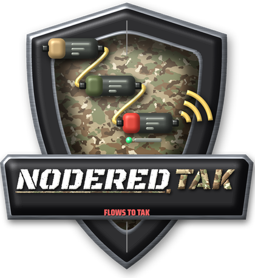

# NodeRED-TAK – Node-RED flows that put public data on the TAK map

<p align="center"></p>

[](https://www.buymeacoffee.com/sect0101)

Ready-to-import [Node-RED](https://nodered.org/) flows that pull free public data feeds (weather, hazards, satellites, radio, mapping) and send them to a TAK Server as CoT, so they show up in ATAK, iTAK, WinTAK and CloudTAK.

- **One folder per flow**, each with its own `flow.json` and a short README.
- **Standard Node-RED nodes**: each flow sends to TAK with a `tcp out` node over TLS (port 8089) using a client certificate.
- **Set up for Tennessee**: flows with an area use a Tennessee bounding box you can change.
- **Old data drops off**: every marker has a stale time, and some flows also delete items that leave the feed.

## Weather and hazards

| Flow | What you get | Updates |
|---|---|---|
| [NHC Tropical Weather](flows/nhc-tropical) | Active tropical storms and hurricanes from the National Hurricane Center: current positions, forecast tracks and cones. | Every 15 minutes |
| [USGS Earthquakes](flows/usgs-earthquakes) | Earthquakes of any magnitude from the past hour, inside Tennessee (plus a small buffer). | Every 60 seconds |
| [USGS Water](flows/usgs-water) | River and stream gauges: gauge height and flow at every active USGS site in Tennessee (plus a small buffer). | Every 15 minutes |
| [NWS River Forecasts](flows/nws-river-forecasts) | NWS forecast river gauges, colored by the worst observed or forecast flood level (purple major, red moderate, orange minor, yellow action, green none). The forecast crest is in the marker remarks. | Every 15 minutes |
| [NWS Local Storm Reports](flows/nws-storm-reports) | Storm reports from spotters, emergency managers and the public (tornadoes, wind damage, hail, flooding) for Tennessee, last 24 hours. | Every 5 minutes |
| [FEMA Disaster Declarations](flows/fema-disaster-declarations) | Tennessee counties under an ongoing FEMA declaration from the last 365 days, drawn as county outlines: major disaster red, emergency orange, fire management yellow. | Every 6 hours |
| [FEMA Open Shelters](flows/fema-open-shelters) | Open shelters in Tennessee from the FEMA National Shelter System (Red Cross and partners). Closed shelters are left off. | Every 15 minutes |
| [Wildfire Incidents & Perimeters](flows/wildfire-incidents) | Current wildfire incidents and their mapped fire perimeters. Fires that leave the feed are removed from the map. | Every 15 minutes |
| [GOES Lightning (GLM)](flows/goes-glm-lightning) | Lightning flashes over Tennessee (plus a small buffer) from the GOES-East Geostationary Lightning Mapper, colored by age (yellow under 5 min, orange 5-10, red 10-15) with flash energy and size in the remarks. Markers drop off after 15 minutes. | Every 60 seconds |
| [Emergency & Wildfire Squawks](flows/emergency-squawks) | Aircraft squawking 7500 (hijack), 7600 (lost comms), 7700 (emergency) or 1255 (firefighting) over Tennessee (plus a small buffer). | Every 17 seconds |

## Space

| Flow | What you get | Updates |
|---|---|---|
| [Weather Satellites](flows/weather-satellites) | Live positions of weather satellites that have an active image downlink (APT, LRPT, HRPT, HRIT), with their frequencies. | Every 30 seconds |
| [Space Stations](flows/space-stations) | Live positions of crewed space stations (ISS, Tiangong) and related objects. | Every 30 seconds |
| [Amateur Radio Satellites](flows/amateur-radio-satellites) | Live positions of active amateur radio satellites, with uplink and downlink frequencies from SatNOGS. | Every 30 seconds |
| [Space Weather](flows/space-weather) | One status marker colored by the current geomagnetic storm level (NOAA G-scale from the Kp index), with active space weather alerts in the remarks. Handy for judging HF conditions. | Every 5 minutes |

## Radio

| Flow | What you get | Updates |
|---|---|---|
| [Winlink RMS Gateways](flows/winlink-rms) | Public Winlink RMS gateways, HF (PACTOR) and VHF/UHF (packet), with callsign, grid square and frequencies. | Every 15 minutes |
| [Meshtastic Nodes](flows/meshtastic) | Meshtastic radios in Tennessee (plus a small buffer) that publish their position to the public Meshtastic MQTT server, shown with their node names. Only nodes whose owners turned on MQTT uplink or map reports appear, and only the default public LongFast channel is decoded. | Live |
| [APRS Stations](flows/aprs) | Live APRS stations in Tennessee (plus a small buffer): mobiles, digipeaters, iGates, objects and weather stations (wind and temperature in the remarks, in °F). Stations show as friendly. | Live |
| [Marinesia AIS Vessels](flows/ais-marinesia) | Boats and ships on Tennessee rivers and lakes from AIS, with MIL-STD-2525 vessel symbols by type (tug, towing, pleasure craft, fishing, passenger and more), flag, destination and navigation status. | Every 30 seconds |

## Mapping

| Flow | What you get | Updates |
|---|---|---|
| [CalTopo](flows/caltopo-streamer) | Streams a CalTopo map into TAK: markers with matching TAK icons, lines and shapes, and live-tracked team members. Items deleted in CalTopo are deleted in TAK. | Every 60 seconds |

## Importing a flow

1. Open the flow's folder and click `flow.json`, then the **Copy raw file** button.
2. In Node-RED: **Menu (≡) > Import**, paste, choose **new flow**, click **Import**.
3. Double-click **TAK Server :8089** and set your TAK Server address.
4. Edit its TLS config (pencil icon), upload your client certificate and key (and the CA if your server needs it).
5. Read the flow's own README for anything else it needs, then click **Deploy**.

Each flow has its own TLS config, so you can import as many as you like. You can use one certificate for all of them, or a separate one per feed so each shows as its own user or channel on the server.

Need a client certificate? Create a user for the feed on your TAK Server and download its certificate, or ask your TAK admin. Node-RED wants it as separate PEM files (certificate and key). To convert a `.p12`:

```sh
openssl pkcs12 -in feed.p12 -clcerts -nokeys -out feed.pem
openssl pkcs12 -in feed.p12 -nocerts -nodes -out feed.key
```

## Satellite and GOES flows

The three satellite flows (orbits, with [satellite.js](https://github.com/shashwatak/satellite-js)) and the GOES lightning flow (satellite files, with [jsfive](https://github.com/usnistgov/jsfive)) load add-on modules. Turn on external modules in Node-RED's `settings.js` and restart:

```js
functionExternalModules: true,
```

Node-RED installs the module by itself the first time the flow deploys. The three satellite flows also need a free [Space-Track.org](https://www.space-track.org/auth/createAccount) account (see each flow's README).

## Changing the area

Flows that cover an area use a Tennessee bounding box (about latitude 34.3 to 37.2, longitude -91.2 to -82.0). It is in the flow's function code or request URL, usually named `TN_BBOX`. Change it to cover your own area.

## Requirements

- Node-RED 4.0 or newer
- A TAK Server with TLS streaming on 8089 (or CloudTAK, OpenTAKServer, FreeTAKServer)
- Internet access from the Node-RED machine to the data sources

## License

[MIT](LICENSE) © 2026 SECT0101. The data belongs to the agencies and projects that publish it; check each source's terms before using it.
